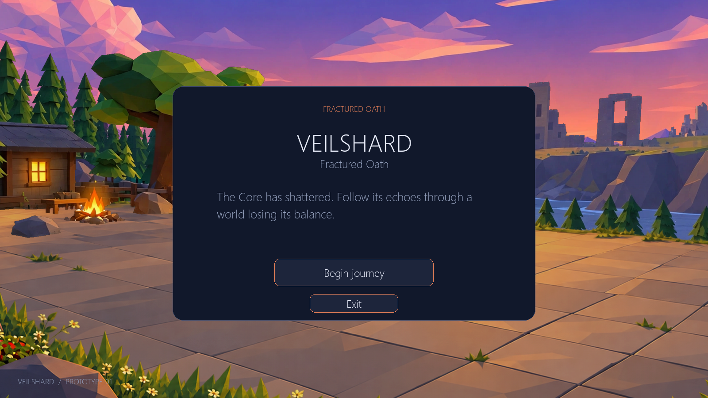
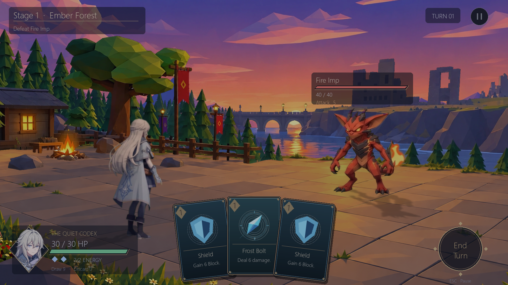
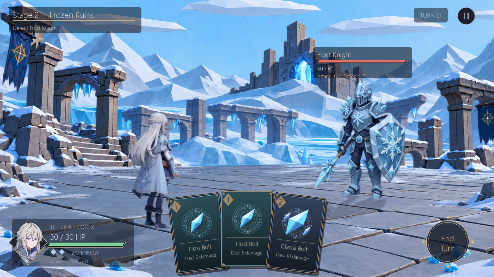
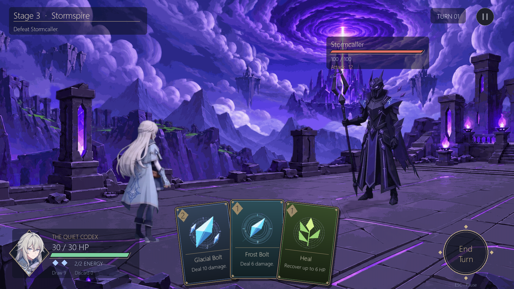
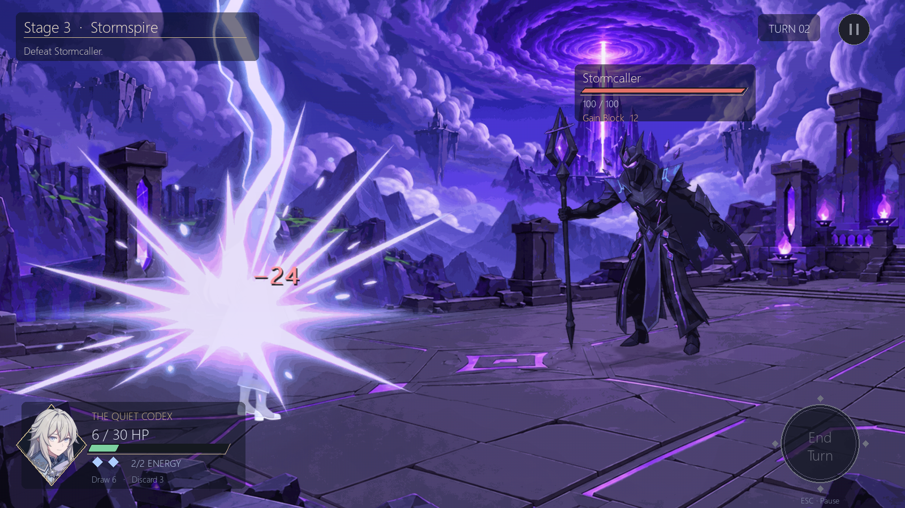
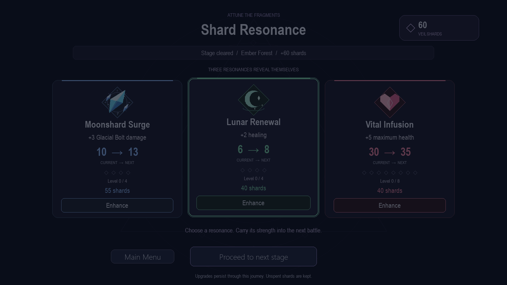

# Veilshard — Fractured Oath

A single-player, anime-inspired low-poly 2.5D turn-based card RPG prototype built with Python and Pygame Community Edition (`pygame-ce`). Follow the echoes of a shattered world to recover ancient fragments across five regions: Ember Forest, Frozen Ruins, Stormspire, Corrupted Grove, and Shattered Citadel.



---

## Current Progress & Showcase

The project features three completed stages with custom multi-layer parallax environments and fully animated adversaries, a between-stage Shard Resonance upgrade system, a moonlit ice card identity, dynamic combat impact camera effects, and a floating HUD. (Stages 4 and 5 remain functional placeholders pending final artwork).

### Completed Stages

#### Stage 1: Ember Forest
Fight through the glowing embers of the autumn woods against the ferocious **Fire Imp**.
- **Parallax Environment**: 5-layer Muse Spark forest with overscan cropping and impact-responsive depth parallax.
- **Opponent**: Fire Imp with frame-animated attacks, biting lunges, hit reactions, and custom ground shadows.



#### Stage 2: Frozen Ruins
Scale the glacial mountain fortress to confront the armored **Frostbound Knight**.
- **Parallax Environment**: 6-layer snowy mountain panorama featuring layered fortress battlements, distant peaks, midground ruins, and rolling mist.
- **Opponent**: Frostbound Knight (60 HP) armed with heavy sword strikes, reactive shield guard, and devastating Glacial Wrath.



#### Stage 3: Stormspire
Ascend the lightning-charged floating spires and face the arcane master, **Stormcaller**.
- **Parallax Environment**: 7-layer atmospheric Stormspire with an animated storm vortex, floating citadel islands, ancient ruins, and layered fog.
- **Opponent**: Stormcaller (100 HP) featuring the **Desperation Vortex** unique passive, multi-projectile Arcane Barrage, defensive Storm Surge (+12/+15 Block with excess block converted to attack power), and catastrophic Thunderfall.
- **Camera & Presentation**: 4-step screen earthquake shake sequence during Thunderfall and synchronized 13th-frame shield burst activation during defensive charges.



*Stormcaller unleashing Thunderfall with full-screen impact shake and directional recoil:*


---

### Shard Resonance (Upgrade System)

Between battles, players enter **Shard Resonance** to channel earned Veil Shards into permanent character enhancements. This attunement system replaces the previous shop interface with interactive card-based choices and crystal sigil visuals.



- **Dynamic Attunement Selection**: Presents 3 distinct upgrades tailored each visit, prioritizing non-maxed attributes:
  - **Vital Infusion**: Increases maximum player HP (+5 per tier).
  - **Frost Focus**: Empowers Frost Bolt damage (+2 per tier).
  - **Crystal Aegis**: Strengthens Shield block value (+2 per tier).
  - **Moonshard Surge**: Amplifies Glacial Bolt heavy damage (+3 per tier).
  - **Lunar Renewal**: Boosts vital card healing (+2 per tier).
  - **Resonance Conduit**: Grants bonus energy on Turn 1 (+1 energy).
- **Interactive Upgrade UI**: Interactive selection with hover elevation, diamond tier progression indicators, authoritative current-to-next stat previews (`10 → 13`), and a release-to-confirm Enhance button with cooldown protection and particle glow.
- **Journey Progression & Retry Flow**: Earn Veil Shards from victory or defeat based on performance. Players can proceed forward upon victory, retry the current stage upon defeat, or return to previously cleared stages for half rewards to reinforce their build.

---

### Moonlit Ice Card Identity

Combat cards carry a cohesive crystalline ice theme with custom procedural icon art and dynamic typography:

- **Frost Bolt** (1 Cost): Fast offensive spell dealing reliable base damage (upgradable via *Frost Focus*).
- **Glacial Bolt** (2 Cost): Heavy strike triggering amplified camera impact recoil, bold damage popups, and hit-stun (upgradable via *Moonshard Surge*).
- **Shield** (1 Cost): Barrier granting Block that absorbs incoming damage before HP (upgradable via *Crystal Aegis*).
- **Heal** (1 Cost): Vital restoration recovering lost health capped at maximum HP (upgradable via *Lunar Renewal*).

Cards are drawn from a 12-card starting deck (3 cards drawn per turn, 2 starting energy) and presented in a shallow 7-degree fan with lift-on-hover, affordability shading, and smooth dissolve animation upon play.

---

## Install and Run

Python 3.11+ is required (tested on Python 3.12).

```powershell
# Setup virtual environment
python -m venv .venv
.\.venv\Scripts\python -m pip install -r requirements.txt

# Launch playable game
.\.venv\Scripts\python main.py

# Instant jump to specific stage (e.g. Stage 3 Stormspire)
.\.venv\Scripts\python main.py --stage 3
```

On macOS/Linux, use `.venv/bin/python` in place of `.\.venv\Scripts\python`. No Blender installation, external fonts, or external runtime services are required. Assets resolve dynamically relative to the project root.

---

## Controls

- **Navigate**: Click **Begin journey** from the main menu, then **Enter battle**.
- **Play Cards**: Hover over cards in your hand to inspect them; left-click an affordable card to play it.
- **End Turn**: Click the glowing **End Turn** orb (bottom-right) to resolve combat and trigger enemy actions.
- **Pause**: Press **Escape** during combat to open the pause menu (resume or return to main menu).
- **Window Scaling**: Freely resize the window or enter full-screen; the 1600×900 logical canvas automatically letterboxes with precision mouse coordinate mapping.

---

## Automated Tests

The test suite validates pure combat models, animation timing, shard resonance logic, UI integration, and headless rendering:

```powershell
# Run the complete test suite (100 tests)
.\.venv\Scripts\python -m pytest -q

# Run headless 120-frame integration check
.\.venv\Scripts\python main.py --headless --frames 120
```

---

## Project Structure

```text
main.py                 Entry point, headless mode, and stage jump options (--stage 1-5)
src/
├── core/               Main game loop, coordinate mapping, resource paths, App coordinator
├── combat/             Pure combat state, fighters, damage/block resolution (Pygame-free)
├── cards/              Card definitions, deck manipulation, and draw/discard cycles
├── enemies/            Enemy intention AI, multi-phase patterns, and unique passives
├── scenes/             Campaign state machine, stage progression, and shard calculations
├── rendering/          Parallax multi-layer backgrounds, character sprites, and camera effects
└── ui/                 Battle HUD, card hand fan, Shard Resonance interface, and procedural icons
data/                   JSON definitions for cards, enemies, stages, and campaign story
assets/                 Multi-layer parallax PNGs and organized enemy sprite frame sequences
docs/                   Design specifications, Blender pipeline, UI contracts, and screenshots
tests/                  100 automated unit, timing, and integration test modules
```

---

## Current Roadmap & Limitations

- **Stages 1–3 Complete**: Environments, parallax manifests, and animated opponents are fully optimized and integrated.
- **Stages 4 & 5 Placeholders**: Corrupted Grove and Shattered Citadel currently utilize placeholder backdrops and prototype enemy archetypes.
- **Upcoming Polish**: Audio integration (BGM & SFX), save system, expanded card variety, and final Blender exports for later stages.
